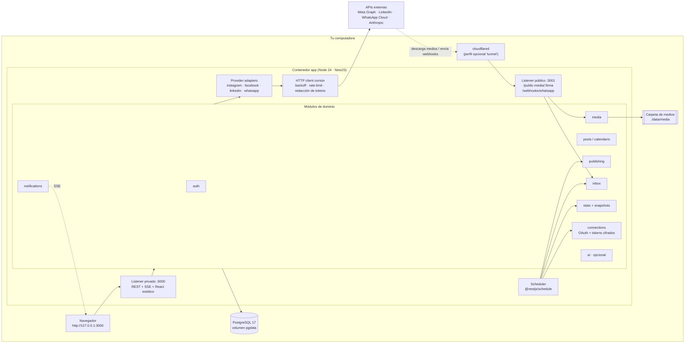

# Paso 2 — Arquitectura local, estructura de carpetas y docker-compose

> Estado: borrador para revisión · Fecha: 2026-10-05
> Depende de: [01-viabilidad-apis.md](./01-viabilidad-apis.md)

---

## 1. Principios

1. **Un solo proceso, un solo puerto para el usuario.** NestJS sirve la API REST, los eventos en tiempo real (SSE) y el frontend React ya compilado. No hay Redis, ni colas, ni microservicios.
2. **Solo localhost por defecto.** La UI escucha en `127.0.0.1:3000` y nunca queda expuesta a la red.
3. **Lo único que se expone a internet es opcional y mínimo:** un segundo *listener* (`:3001`) que solo atiende medios con URL firmada y webhooks de WhatsApp. Solo es alcanzable si el usuario activa el túnel.
4. **Las redes son adaptadores intercambiables.** El núcleo (calendario, bandeja, estadísticas) no sabe nada de Meta ni de LinkedIn; solo conoce `ProviderAdapter` y sus `capabilities()`.
5. **Tolerante a "el PC estaba apagado".** Cada tarea programada es idempotente y tiene recuperación al arrancar.

---

## 2. Diagrama



### Flujos clave
- **Publicar en IG:** el cron (cada minuto) toma un post que ya vence y genera una URL firmada `https://<túnel>/public-media/<hmac>` (válida 1 h). Luego crea el contenedor en IG, espera a que esté `FINISHED`, publica, guarda el `external_id` y notifica.
- **Publicar en FB/LinkedIn:** subida binaria directa desde el disco, sin túnel.
- **Bandeja:** un cron (cada 5 min, configurable) pide comentarios y DMs nuevos con un cursor por cuenta, los guarda deduplicados por `external_id` y notifica. WhatsApp entra por webhook a través del túnel.
- **Snapshots:** un cron diario (03:00 en la zona horaria del usuario) guarda las métricas de cada cuenta y de los posts recientes. Hay otro cron horario para las Stories de IG y un botón "Sincronizar ahora".

---

## 3. Decisiones técnicas (y por qué)

| Decisión | Elección | Por qué |
|---|---|---|
| Monorepo | **npm workspaces** (`apps/api`, `apps/web`, `packages/shared`) | Viene con Node y no exige instalar pnpm ni turbo. `npm install` en la raíz y listo |
| Runtime | **Node 24 LTS** | LTS activo en octubre de 2026 |
| ORM | **Prisma 7** con `@prisma/adapter-pg` | Tipos generados desde el schema, migraciones versionadas, soporte nativo de `Json`/JSONB y `$queryRawTyped`/TypedSQL para las consultas de series temporales. TypeORM se integra mejor con Nest, pero da tipos más débiles y su mantenimiento ha sido irregular |
| Validación | **class-validator / class-transformer** para DTOs **y** para el entorno (`ConfigModule.validate`) | Una sola librería de validación, como pediste |
| Contratos front/back | `@nestjs/swagger` genera OpenAPI y `openapi-typescript` genera los tipos del frontend | Una sola fuente de verdad sin compartir clases con decoradores |
| `packages/shared` | Reglas por red (límites de caracteres, formatos, nº de hashtags, ratios de imagen) y enums | Las usan el editor del frontend (validación en vivo) y el backend (validación final) |
| Programación | **@nestjs/schedule** + tabla `posts` como "cola" | Sin Redis. Un solo proceso, transiciones de estado atómicas con `UPDATE … WHERE status = 'scheduled'` |
| Tiempo real | **SSE** (`@Sse()` de Nest) | Unidireccional, nativo del navegador, sin websockets ni librerías extra |
| Logs | **nestjs-pino** con `redact` (`authorization`, `*.access_token`, `*.refresh_token`, `*.token`, `password`, query `access_token`) | Garantiza que nunca se registra un token |
| Cifrado de tokens | **AES-256-GCM** con `APP_ENCRYPTION_KEY` (32 bytes), IV aleatorio por valor, columna `key_version` para rotar | Estándar, autenticado y sin dependencias (`node:crypto`) |
| Contraseña | **argon2id** | Recomendación actual de OWASP |
| Sesión | Cookie `httpOnly`, `SameSite=Strict`, sesión en BD | Revocable. Con SameSite estricto y solo localhost no hace falta un token CSRF aparte |
| Imágenes | **sharp** (miniaturas y conversión a JPEG para IG) | Rápido y con binarios precompilados |
| Frontend | Vite · React · TS · **Tailwind v4** · shadcn/ui · TanStack Query · React Router · **Recharts** · FullCalendar (núcleo MIT) | Ecosistema maduro. Recharts encaja de forma natural con React |
| Tests | API: **Jest** (lo trae Nest) + **Testcontainers** (Postgres real) + **nock** para simular las APIs de las redes. Web: **Vitest** + Testing Library | Los tests de integración contra un Postgres real detectan errores de SQL y JSONB que un mock no ve |

---

## 4. Base de datos: PostgreSQL vs. SQLite (trade-off)

| | PostgreSQL (vía Docker) | SQLite (archivo local) |
|---|---|---|
| Instalación | Necesita Docker (o Postgres nativo) | Nada; es un archivo |
| JSONB e índices sobre JSON | ✅ JSONB, índices GIN, operadores | ⚠️ JSON como texto, funciones `json_*`, sin GIN |
| Series temporales | ✅ `date_trunc`, `generate_series` (rellenar días sin datos), ventanas `LAG()` para ganados/perdidos | ⚠️ ventanas sí; sin `generate_series` (CTE recursiva) y fechas como texto |
| Concurrencia (cron + API a la vez) | ✅ | ⚠️ un solo escritor (WAL ayuda, pero puede haber `SQLITE_BUSY`) |
| Backups | `pg_dump` | Copiar un archivo (muy cómodo) |
| Coste de soportar **ambos** | — | En Prisma el `provider` es fijo por schema: **dos schemas, dos historiales de migraciones, el doble de SQL crudo en estadísticas y una doble matriz de tests** |

**Recomendación: solo PostgreSQL.** El módulo de estadísticas, que es el corazón del producto, depende de JSONB, de `generate_series` y de funciones de fecha. Soportar dos motores duplicaría el mantenimiento de la parte más compleja. La fricción de instalación se resuelve con `docker compose up`. Para quien no quiera Docker, el README explicará cómo instalar Postgres nativo (unos 5 minutos en Windows, macOS y Linux).

---

## 5. Estructura de carpetas

```
socialhub/
├─ apps/
│  ├─ api/                              # NestJS
│  │  ├─ prisma/
│  │  │  ├─ schema.prisma
│  │  │  ├─ migrations/
│  │  │  └─ sql/                        # TypedSQL: consultas de estadísticas
│  │  ├─ src/
│  │  │  ├─ main.ts                     # arranca los listeners :3000 y :3001
│  │  │  ├─ app.module.ts
│  │  │  ├─ config/                     # EnvironmentVariables + validate()
│  │  │  ├─ common/
│  │  │  │  ├─ errors/                   # AppError, códigos, filtro global
│  │  │  │  ├─ http/                     # cliente con backoff, rate-limit, redacción
│  │  │  │  ├─ crypto/                   # AES-256-GCM, URLs firmadas HMAC
│  │  │  │  └─ logging/
│  │  │  ├─ prisma/                     # PrismaService
│  │  │  └─ modules/
│  │  │     ├─ auth/                     # setup inicial, login, sesión
│  │  │     ├─ connections/              # OAuth, cuentas, renovación de tokens
│  │  │     ├─ providers/
│  │  │     │  ├─ provider-adapter.ts    # interfaz + capabilities
│  │  │     │  ├─ provider-registry.ts
│  │  │     │  ├─ meta/                  # graph-client compartido
│  │  │     │  │  ├─ instagram/
│  │  │     │  │  ├─ facebook/
│  │  │     │  │  └─ whatsapp/           # fase 2
│  │  │     │  └─ linkedin/
│  │  │     ├─ posts/                    # calendario, borradores, variantes por red
│  │  │     ├─ publishing/               # cron, recuperación, idempotencia
│  │  │     ├─ media/                    # biblioteca, miniaturas, URLs firmadas
│  │  │     ├─ inbox/                    # comentarios + DMs, polling y webhooks
│  │  │     ├─ notifications/            # persistencia + SSE
│  │  │     ├─ stats/                    # snapshots, agregaciones, export CSV/PDF
│  │  │     ├─ public-gateway/           # controladores del listener :3001
│  │  │     ├─ settings/
│  │  │     └─ ai/                       # opcional, Claude API
│  │  └─ test/                           # e2e + fixtures de APIs simuladas
│  └─ web/                               # React + Vite
│     └─ src/
│        ├─ app/                         # router, providers, layout
│        ├─ features/
│        │  ├─ auth/ calendar/ composer/ media/ inbox/
│        │  └─ stats/ connections/ notifications/ settings/
│        ├─ components/ui/               # shadcn/ui
│        ├─ lib/                         # api client (tipos OpenAPI), sse
│        └─ styles/
├─ packages/
│  └─ shared/                            # reglas por red, enums
├─ docs/
│  ├─ design/                            # estos documentos
│  ├─ setup-meta.md
│  ├─ setup-linkedin.md
│  ├─ setup-whatsapp.md
│  └─ troubleshooting.md
├─ scripts/
│  └─ setup.mjs                          # crea .env con claves aleatorias
├─ .github/workflows/ci.yml              # lint + test + build
├─ docker-compose.yml
├─ Dockerfile
├─ .env.example
├─ .gitignore
├─ .dockerignore
├─ LICENSE                               # MIT
├─ README.md
└─ package.json                          # workspaces + scripts raíz
```

---

## 6. docker-compose.yml (borrador)

```yaml
name: socialhub

services:
  db:
    image: postgres:17-alpine
    environment:
      POSTGRES_USER: ${POSTGRES_USER:-socialhub}
      POSTGRES_PASSWORD: ${POSTGRES_PASSWORD:?Falta POSTGRES_PASSWORD en .env (ejecuta npm run setup)}
      POSTGRES_DB: ${POSTGRES_DB:-socialhub}
    volumes:
      - pgdata:/var/lib/postgresql/data
    ports:
      - "127.0.0.1:${DB_PORT:-5432}:5432"   # solo para `npm run dev` desde el host
    healthcheck:
      test: ["CMD-SHELL", "pg_isready -U $${POSTGRES_USER} -d $${POSTGRES_DB}"]
      interval: 5s
      timeout: 5s
      retries: 10
    restart: unless-stopped

  app:
    build: .
    env_file: .env
    environment:
      DATABASE_URL: postgresql://${POSTGRES_USER:-socialhub}:${POSTGRES_PASSWORD}@db:5432/${POSTGRES_DB:-socialhub}
      MEDIA_DIR: /data/media
      PUBLIC_GATEWAY_PORT: 3001
      TUNNEL_METRICS_URL: http://tunnel:2000   # la app lee aquí la URL pública del túnel
    depends_on:
      db:
        condition: service_healthy
    ports:
      - "127.0.0.1:${APP_PORT:-3000}:3000"      # la UI solo es accesible desde tu PC
    volumes:
      - ${MEDIA_HOST_DIR:-./data/media}:/data/media
    restart: unless-stopped

  tunnel:                                       # opcional: docker compose --profile tunnel up
    profiles: ["tunnel"]
    image: cloudflare/cloudflared:2026.9.0      # se fija la versión exacta al implementar
    command: tunnel --no-autoupdate --metrics 0.0.0.0:2000 --url http://app:3001
    depends_on: [app]
    restart: unless-stopped

volumes:
  pgdata:
```

**Notas:**
- El túnel apunta **solo** a `:3001`, que nunca sirve la UI ni la API privada. La app obtiene la URL pública del *quick tunnel* desde el endpoint de métricas de cloudflared (`/quicktunnel`), sin que el usuario tenga que copiarla. Quien prefiera ngrok o un túnel con nombre propio puede definir `PUBLIC_BASE_URL` en `.env`.
- El `Dockerfile` es *multi-stage*: build de `web` y `api`, imagen final `node:24-alpine` sin dependencias de desarrollo. El *entrypoint* ejecuta `prisma migrate deploy` antes de arrancar.

### Comandos para quien clona el repo
```bash
git clone https://github.com/Ezy01v1/GestorRedes.git && cd GestorRedes
npm run setup          # copia .env.example → .env y genera claves aleatorias
docker compose up -d   # abre http://127.0.0.1:3000 y crea tu contraseña
```
Modo desarrollo: `docker compose up -d db` y después `npm install && npm run dev` (API con *watch* + Vite con proxy a la API).

---

## 7. .env.example (borrador)

```dotenv
# ── General ──────────────────────────────────────────────
APP_PORT=3000
TZ=America/Mexico_City            # zona horaria del calendario y de los crons
APP_BASE_URL=http://127.0.0.1:3000

# ── Seguridad (npm run setup los genera) ─────────────────
APP_ENCRYPTION_KEY=               # 32 bytes en base64: cifra los tokens de las redes
SESSION_SECRET=                   # 32 bytes en base64
MEDIA_SIGNING_SECRET=             # 32 bytes en base64: firma URLs públicas de medios

# ── Base de datos ────────────────────────────────────────
POSTGRES_USER=socialhub
POSTGRES_PASSWORD=
POSTGRES_DB=socialhub
DATABASE_URL=                     # solo para npm run dev; npm run setup la escribe con la contraseña generada (en Docker la define compose)

# ── Medios ───────────────────────────────────────────────
MEDIA_HOST_DIR=./data/media       # carpeta en tu PC (Docker)
MEDIA_DIR=./data/media            # carpeta en modo npm run dev

# ── Túnel público (opcional, necesario para IG y WhatsApp) ─
PUBLIC_BASE_URL=                  # vacío = se autodetecta del perfil "tunnel"

# ── Meta (Instagram, Facebook, WhatsApp) ─────────────────
META_APP_ID=
META_APP_SECRET=
META_GRAPH_VERSION=v26.0
INSTAGRAM_APP_ID=                 # Instagram Login usa su propio app id y secret
INSTAGRAM_APP_SECRET=
WHATSAPP_WEBHOOK_VERIFY_TOKEN=    # fase 2

# ── LinkedIn ─────────────────────────────────────────────
LINKEDIN_CLIENT_ID=
LINKEDIN_CLIENT_SECRET=
LINKEDIN_API_VERSION=202609

# ── Comportamiento ───────────────────────────────────────
INBOX_POLL_MINUTES=5
SNAPSHOT_CRON=0 3 * * *
MISSED_POST_GRACE_MINUTES=60      # si el PC estuvo apagado: publicar tarde dentro de esta ventana; si no, marcar "perdido"
```

Las credenciales de las redes van en `.env` y **no** en la base de datos: son de la app, no del usuario. Lo que sí va a la BD (cifrado) son los tokens OAuth obtenidos. La API key de Anthropic, que es opcional, se guarda cifrada desde la pantalla de Ajustes.

`.gitignore` incluirá como mínimo: `.env`, `.env.*` (excepto `.env.example`), `data/`, `node_modules/`, `dist/`, `coverage/` y `*.log`.

---

## 8. Tareas programadas

| Cron | Frecuencia | Qué hace | Recuperación al arrancar |
|---|---|---|---|
| `publish-due` | cada minuto | Publica los posts con `scheduled_at <= ahora` | Los vencidos dentro de `MISSED_POST_GRACE_MINUTES` se publican; los más antiguos pasan a `missed` y se notifica |
| `inbox-poll` | cada `INBOX_POLL_MINUTES` | Trae comentarios y DMs nuevos | Ejecución inmediata |
| `token-refresh` | cada hora | Renueva los tokens que caducan en menos de 7 días; avisa de los que no se pueden renovar (LinkedIn) | Ejecución inmediata |
| `stories-metrics` | cada hora | Snapshot de las Stories de IG activas (viven 24 h) | Ejecución inmediata |
| `daily-snapshot` | `SNAPSHOT_CRON` | Snapshot de cuenta y de los posts de los últimos 30 días | Si falta el snapshot de hoy, se toma. Si hay huecos, *backfill* donde la API lo permita |
| `media-cleanup` | diario | Borra archivos temporales y firmas caducadas | — |

**Idempotencia de la publicación:** `scheduled → publishing` es un `UPDATE` condicional. Si el proceso muere con un post en `publishing`, al arrancar **no se reintenta automáticamente**: pasa a `needs_review` y se avisa al usuario, porque es preferible pedir confirmación a publicar dos veces.

---

## 9. Seguridad (resumen)

- La UI y la API solo escuchan en `127.0.0.1`. El listener público solo tiene dos rutas: medios con firma HMAC que caduca en 1 h y webhooks de WhatsApp validados con `X-Hub-Signature-256` y el `app secret`.
- `helmet`, `@nestjs/throttler` en el login, cookies `httpOnly` + `SameSite=Strict`.
- OAuth con `state` aleatorio guardado en la sesión, y PKCE donde la red lo soporta.
- Tokens cifrados en la BD, redactados en los logs y nunca enviados al frontend.
- Arranque **fallido a propósito** si falta o es inválida alguna variable obligatoria (por ejemplo, una `APP_ENCRYPTION_KEY` que no sean 32 bytes).
