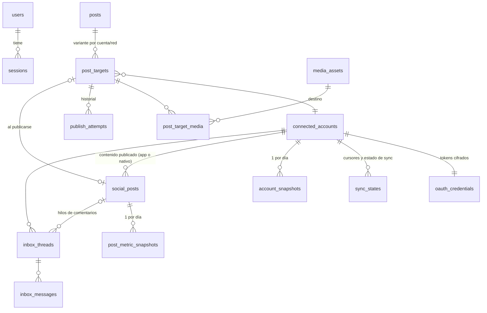

# Paso 3 — Modelo de datos (PostgreSQL + Prisma 7)

> Estado: borrador para revisión · Fecha: 2026-10-05
> Depende de: [01-viabilidad-apis.md](./01-viabilidad-apis.md), [02-arquitectura.md](./02-arquitectura.md)

---

## 1. Mapa de entidades



**Ideas centrales:**
- **`posts` es el contenido "maestro" y `post_targets` es su adaptación a cada cuenta.** Cada target tiene su propio texto, formato, medios, hora y **estado**. Así, un post puede salir en IG y fallar en LinkedIn sin que el estado global quede ambiguo.
- **`social_posts` contiene todo lo publicado en la cuenta**, también lo que publicaste desde el móvil. Lo necesitamos para el ranking y los mejores horarios. Si salió desde la app, se enlaza con su `post_target`.
- **Los snapshots usan JSONB con claves canónicas** (`followers_count`, `reach`…), iguales en todas las redes. El adaptador traduce las métricas de Meta o LinkedIn a esas claves.

---

## 2. Convenciones

| Tema | Decisión | Por qué |
|---|---|---|
| IDs | `uuid(7)` en entidades; `BigInt autoincrement` en snapshots | UUIDv7 está ordenado por tiempo (buena localidad de índice) y no revela conteos. Los snapshots son de alto volumen y uso interno |
| Fechas | `timestamptz(3)` siempre en UTC | La zona del usuario (`TZ`) solo se aplica al mostrar y al decidir a qué "día" pertenece un snapshot |
| Día del snapshot | columna `snapshot_date date` (día local del usuario) | Las gráficas agrupan por día local; evita que un snapshot de las 23:30 caiga en el día siguiente en UTC |
| Nombres | Tablas y columnas en `snake_case` (`@@map`/`@map`); modelos en `PascalCase` | SQL legible para las consultas de estadísticas |
| Borrado | Físico, salvo `posts` (soft delete con `deleted_at`) | Recuperar un post borrado por error; el resto no lo necesita (YAGNI) |
| Tokens | `Bytes` = `iv(12) ‖ tag(16) ‖ ciphertext`, más `key_version` | AES-256-GCM; permite rotar `APP_ENCRYPTION_KEY` |
| Métricas | Clave **ausente** = la red no la soporta · **`null`** = la soporta, pero no hubo dato ese día (p. ej. <100 seguidores) | La UI distingue "no aplica" de "sin datos" |

---

## 3. Schema Prisma (borrador)

```prisma
generator client {
  provider = "prisma-client"
  output   = "../src/generated/prisma"
}

datasource db {
  provider = "postgresql"
}

// ───────────────────────── Enums ─────────────────────────

enum Network {
  INSTAGRAM
  FACEBOOK
  LINKEDIN
  WHATSAPP
  // fase 3: THREADS, YOUTUBE, X, PINTEREST, GOOGLE_BUSINESS
}

enum AccountKind {
  IG_BUSINESS
  IG_CREATOR
  FB_PAGE
  LI_MEMBER
  LI_ORGANIZATION
  WA_PHONE_NUMBER
}

enum AccountStatus {
  ACTIVE
  NEEDS_RECONNECT   // token caducado/revocado o permisos retirados
  DISABLED          // el usuario la pausó
}

enum PostFormat {
  FEED              // IG/FB foto o video en el feed
  CAROUSEL
  REEL
  STORY
  TEXT              // LinkedIn/FB solo texto o con enlace
  DOCUMENT          // LinkedIn PDF carrusel
}

enum TargetStatus {
  DRAFT
  SCHEDULED
  PUBLISHING
  PUBLISHED
  FAILED
  MISSED            // el PC estaba apagado y se superó la ventana de gracia
  NEEDS_REVIEW      // el proceso murió durante la publicación: confirmar manualmente
  CANCELED
}

enum MediaKind {
  IMAGE
  VIDEO
}

enum SnapshotSource {
  CRON
  MANUAL
  BACKFILL
}

enum ThreadKind {
  COMMENT           // comentario raíz + sus respuestas
  DIRECT            // DM / Messenger / WhatsApp
}

enum ThreadStatus {
  OPEN
  DONE
}

enum Direction {
  INBOUND
  OUTBOUND
}

enum NotificationType {
  POST_PUBLISHED
  POST_FAILED
  POST_MISSED
  POST_NEEDS_REVIEW
  TOKEN_EXPIRING
  ACCOUNT_NEEDS_RECONNECT
  NEW_COMMENT
  NEW_MESSAGE
  SYNC_FAILED
  RATE_LIMITED
}

enum Severity {
  INFO
  SUCCESS
  WARNING
  ERROR
}

// ───────────────────── Acceso local ─────────────────────

model User {
  id           String    @id @default(uuid(7))
  singleton    Boolean   @unique @default(true)   // + CHECK (singleton) → un solo usuario
  username     String
  passwordHash String    @map("password_hash")    // argon2id
  createdAt    DateTime  @default(now()) @map("created_at") @db.Timestamptz(3)
  updatedAt    DateTime  @updatedAt @map("updated_at") @db.Timestamptz(3)
  sessions     Session[]

  @@map("users")
}

model Session {
  id         String   @id @default(uuid(7))
  tokenHash  String   @unique @map("token_hash")   // SHA-256 del valor de la cookie
  userId     String   @map("user_id")
  user       User     @relation(fields: [userId], references: [id], onDelete: Cascade)
  userAgent  String?  @map("user_agent")
  expiresAt  DateTime @map("expires_at") @db.Timestamptz(3)
  lastSeenAt DateTime @default(now()) @map("last_seen_at") @db.Timestamptz(3)
  createdAt  DateTime @default(now()) @map("created_at") @db.Timestamptz(3)

  @@index([expiresAt])
  @@map("sessions")
}

model OAuthState {
  state        String   @id                          // aleatorio, 32 bytes
  network      Network
  codeVerifier String?  @map("code_verifier")        // PKCE si la red lo soporta
  redirectTo   String?  @map("redirect_to")
  expiresAt    DateTime @map("expires_at") @db.Timestamptz(3)  // 10 min

  @@map("oauth_states")
}

// ───────────────────── Cuentas conectadas ─────────────────────

model ConnectedAccount {
  id          String        @id @default(uuid(7))
  network     Network
  kind        AccountKind
  externalId  String        @map("external_id")      // IG user id, Page id, URN de LinkedIn, phone_number_id
  displayName String        @map("display_name")
  username    String?
  avatarUrl   String?       @map("avatar_url")
  status      AccountStatus @default(ACTIVE)
  scopes      String[]                                // permisos concedidos → capabilities()
  metadata    Json          @default("{}")            // datos propios de la red (p. ej. ig_user_id ↔ page_id)
  connectedAt DateTime      @default(now()) @map("connected_at") @db.Timestamptz(3)
  updatedAt   DateTime      @updatedAt @map("updated_at") @db.Timestamptz(3)

  credential       OAuthCredential?
  syncStates       SyncState[]
  snapshots        AccountSnapshot[]
  socialPosts      SocialPost[]
  postTargets      PostTarget[]
  inboxThreads     InboxThread[]

  @@unique([network, externalId])
  @@map("connected_accounts")
}

model OAuthCredential {
  accountId        String           @id @map("account_id")
  account          ConnectedAccount @relation(fields: [accountId], references: [id], onDelete: Cascade)
  accessTokenEnc   Bytes            @map("access_token_enc")
  refreshTokenEnc  Bytes?           @map("refresh_token_enc")
  keyVersion       Int              @default(1) @map("key_version")
  expiresAt        DateTime?        @map("expires_at") @db.Timestamptz(3)        // null = no expira (Page token)
  refreshExpiresAt DateTime?        @map("refresh_expires_at") @db.Timestamptz(3)
  lastRefreshedAt  DateTime?        @map("last_refreshed_at") @db.Timestamptz(3)
  lastRefreshError String?          @map("last_refresh_error")                   // mensaje saneado, nunca el token

  @@index([expiresAt])
  @@map("oauth_credentials")
}

/// Estado de cada sincronización por cuenta: cursores de bandeja, último snapshot, errores.
model SyncState {
  accountId     String           @map("account_id")
  account       ConnectedAccount @relation(fields: [accountId], references: [id], onDelete: Cascade)
  resource      String           // 'comments' | 'messages' | 'account_snapshot' | 'post_metrics' | 'stories'
  cursor        String?
  lastRunAt     DateTime?        @map("last_run_at") @db.Timestamptz(3)
  lastSuccessAt DateTime?        @map("last_success_at") @db.Timestamptz(3)
  lastError     String?          @map("last_error")
  backoffUntil  DateTime?        @map("backoff_until") @db.Timestamptz(3)       // tras un rate limit

  @@id([accountId, resource])
  @@map("sync_states")
}

// ───────────────────── Biblioteca de medios ─────────────────────

model MediaAsset {
  id               String    @id @default(uuid(7))
  kind             MediaKind
  storagePath      String    @unique @map("storage_path")     // relativo a MEDIA_DIR: 2026/10/<uuid>.jpg
  thumbnailPath    String?   @map("thumbnail_path")
  originalFilename String    @map("original_filename")
  mimeType         String    @map("mime_type")
  sizeBytes        BigInt    @map("size_bytes")
  sha256           String    @unique                          // evita duplicados al subir
  width            Int?
  height           Int?
  durationMs       Int?      @map("duration_ms")
  altText          String?   @map("alt_text")
  tags             String[]
  createdAt        DateTime  @default(now()) @map("created_at") @db.Timestamptz(3)

  usages PostTargetMedia[]

  @@index([createdAt(sort: Desc)])
  @@map("media_assets")
}

// ───────────────────── Calendario y publicación ─────────────────────

model Post {
  id        String       @id @default(uuid(7))
  title     String?                                   // nombre interno en el calendario
  baseText  String       @default("") @map("base_text") // texto origen antes de adaptar
  notes     String?
  createdAt DateTime     @default(now()) @map("created_at") @db.Timestamptz(3)
  updatedAt DateTime     @updatedAt @map("updated_at") @db.Timestamptz(3)
  deletedAt DateTime?    @map("deleted_at") @db.Timestamptz(3)

  targets PostTarget[]

  @@map("posts")
}

model PostTarget {
  id                 String       @id @default(uuid(7))
  postId             String       @map("post_id")
  post               Post         @relation(fields: [postId], references: [id], onDelete: Cascade)
  accountId          String       @map("account_id")
  account            ConnectedAccount @relation(fields: [accountId], references: [id], onDelete: Restrict)
  format             PostFormat
  text               String       @default("")         // ya adaptado: caracteres, hashtags, menciones
  firstComment       String?      @map("first_comment") // IG: hashtags en el primer comentario
  options            Json         @default("{}")       // por red: visibilidad LinkedIn, link FB, share_to_feed de Reels…
  status             TargetStatus @default(DRAFT)
  scheduledAt        DateTime?    @map("scheduled_at") @db.Timestamptz(3)
  publishStartedAt   DateTime?    @map("publish_started_at") @db.Timestamptz(3)
  publishedAt        DateTime?    @map("published_at") @db.Timestamptz(3)
  providerContainerId String?     @map("provider_container_id") // IG: contenedor creado, para reanudar
  externalId         String?      @map("external_id")
  externalUrl        String?      @map("external_url")
  lastError          Json?        @map("last_error")   // { code, message, retryable, providerCode }
  createdAt          DateTime     @default(now()) @map("created_at") @db.Timestamptz(3)
  updatedAt          DateTime     @updatedAt @map("updated_at") @db.Timestamptz(3)

  media      PostTargetMedia[]
  attempts   PublishAttempt[]
  socialPost SocialPost?

  @@unique([postId, accountId, format])
  @@index([accountId, scheduledAt])
  @@map("post_targets")
}

model PostTargetMedia {
  targetId String     @map("target_id")
  target   PostTarget @relation(fields: [targetId], references: [id], onDelete: Cascade)
  mediaId  String     @map("media_id")
  media    MediaAsset @relation(fields: [mediaId], references: [id], onDelete: Restrict) // no se puede borrar un medio en uso
  position Int

  @@id([targetId, position])
  @@index([mediaId])
  @@map("post_target_media")
}

model PublishAttempt {
  id         String     @id @default(uuid(7))
  targetId   String     @map("target_id")
  target     PostTarget @relation(fields: [targetId], references: [id], onDelete: Cascade)
  startedAt  DateTime   @default(now()) @map("started_at") @db.Timestamptz(3)
  finishedAt DateTime?  @map("finished_at") @db.Timestamptz(3)
  outcome    String?    // 'success' | 'retryable_error' | 'fatal_error' | 'interrupted'
  httpStatus Int?       @map("http_status")
  error      Json?

  @@index([targetId, startedAt])
  @@map("publish_attempts")
}

model HashtagSet {
  id        String    @id @default(uuid(7))
  name      String    @unique
  tags      String[]
  networks  Network[]                                  // vacío = todas
  createdAt DateTime  @default(now()) @map("created_at") @db.Timestamptz(3)

  @@map("hashtag_sets")
}

// ───────────────────── Contenido publicado y estadísticas ─────────────────────

/// Todo lo publicado en la cuenta (desde la app o fuera de ella). Base del ranking y de los mejores horarios.
model SocialPost {
  id           String           @id @default(uuid(7))
  accountId    String           @map("account_id")
  account      ConnectedAccount @relation(fields: [accountId], references: [id], onDelete: Cascade)
  externalId   String           @map("external_id")
  postTargetId String?          @unique @map("post_target_id")
  postTarget   PostTarget?      @relation(fields: [postTargetId], references: [id], onDelete: SetNull)
  format       PostFormat
  caption      String?
  permalink    String?
  thumbnailUrl String?          @map("thumbnail_url")
  publishedAt  DateTime         @map("published_at") @db.Timestamptz(3)
  expiresAt    DateTime?        @map("expires_at") @db.Timestamptz(3)         // Stories: published_at + 24 h
  latestMetrics Json            @default("{}") @map("latest_metrics")        // copia del último snapshot (ranking rápido)
  metricsUpdatedAt DateTime?    @map("metrics_updated_at") @db.Timestamptz(3)

  metricSnapshots PostMetricSnapshot[]
  inboxThreads    InboxThread[]

  @@unique([accountId, externalId])
  @@index([accountId, publishedAt(sort: Desc)])
  @@map("social_posts")
}

/// SNAPSHOT DIARIO DE CUENTA: la base de todas las series históricas.
model AccountSnapshot {
  id             BigInt           @id @default(autoincrement())
  accountId      String           @map("account_id")
  account        ConnectedAccount @relation(fields: [accountId], references: [id], onDelete: Cascade)
  network        Network                               // desnormalizado: consultas consolidadas sin JOIN
  snapshotDate   DateTime         @map("snapshot_date") @db.Date
  capturedAt     DateTime         @default(now()) @map("captured_at") @db.Timestamptz(3)
  source         SnapshotSource
  metrics        Json                                  // claves canónicas (ver §4)
  raw            Json?                                 // respuesta de la API saneada, para depurar cambios de Meta
  catalogVersion Int              @map("catalog_version") // versión del catálogo de métricas usado
  apiVersion     String           @map("api_version")  // 'v26.0', '202609'…

  @@unique([accountId, snapshotDate])   // 1 por día; "Sincronizar ahora" hace upsert sobre el de hoy
  @@index([network, snapshotDate])      // dashboard consolidado por red y rango
  @@index([snapshotDate])               // consolidado global por rango
  @@map("account_snapshots")
}

model PostMetricSnapshot {
  id             BigInt     @id @default(autoincrement())
  socialPostId   String     @map("social_post_id")
  socialPost     SocialPost @relation(fields: [socialPostId], references: [id], onDelete: Cascade)
  snapshotDate   DateTime   @map("snapshot_date") @db.Date
  capturedAt     DateTime   @default(now()) @map("captured_at") @db.Timestamptz(3)
  metrics        Json
  catalogVersion Int        @map("catalog_version")

  @@unique([socialPostId, snapshotDate])
  @@index([snapshotDate])
  @@map("post_metric_snapshots")
}

// ───────────────────── Bandeja unificada ─────────────────────

model InboxThread {
  id                  String           @id @default(uuid(7))
  accountId           String           @map("account_id")
  account             ConnectedAccount @relation(fields: [accountId], references: [id], onDelete: Cascade)
  kind                ThreadKind
  externalId          String           @map("external_id")  // id del comentario raíz o de la conversación
  socialPostId        String?          @map("social_post_id")
  socialPost          SocialPost?      @relation(fields: [socialPostId], references: [id], onDelete: SetNull)
  participantName     String?          @map("participant_name")
  participantHandle   String?          @map("participant_handle")
  participantExternalId String?        @map("participant_external_id")
  status              ThreadStatus     @default(OPEN)
  unreadCount         Int              @default(0) @map("unread_count")
  lastMessageAt       DateTime         @map("last_message_at") @db.Timestamptz(3)
  replyWindowEndsAt   DateTime?        @map("reply_window_ends_at") @db.Timestamptz(3) // DMs: ventana de 24 h

  messages InboxMessage[]

  @@unique([accountId, kind, externalId])
  @@index([status, lastMessageAt(sort: Desc)])
  @@index([accountId, lastMessageAt(sort: Desc)])
  @@map("inbox_threads")
}

model InboxMessage {
  id               String      @id @default(uuid(7))
  threadId         String      @map("thread_id")
  thread           InboxThread @relation(fields: [threadId], references: [id], onDelete: Cascade)
  externalId       String      @map("external_id")
  direction        Direction
  authorName       String?     @map("author_name")
  authorExternalId String?     @map("author_external_id")
  text             String?
  attachments      Json        @default("[]")
  isHidden         Boolean     @default(false) @map("is_hidden")   // comentario oculto en la red
  sentAt           DateTime    @map("sent_at") @db.Timestamptz(3)
  readAt           DateTime?   @map("read_at") @db.Timestamptz(3)

  @@unique([threadId, externalId])          // deduplicación del polling
  @@index([threadId, sentAt])
  @@map("inbox_messages")
}

// ───────────────────── Notificaciones y ajustes ─────────────────────

model Notification {
  id        String           @id @default(uuid(7))
  type      NotificationType
  severity  Severity
  title     String
  body      String?
  link      String?                                  // ruta interna, p. ej. /calendar?post=…
  refs      Json             @default("{}")          // { postId, targetId, accountId, threadId }
  readAt    DateTime?        @map("read_at") @db.Timestamptz(3)
  createdAt DateTime         @default(now()) @map("created_at") @db.Timestamptz(3)

  @@index([createdAt(sort: Desc)])
  @@map("notifications")
}

model AppSetting {
  key       String   @id                // 'ai.enabled', 'publishing.missed_policy', 'stats.engagement_basis'…
  value     Json
  updatedAt DateTime @updatedAt @map("updated_at") @db.Timestamptz(3)

  @@map("app_settings")
}

model AppSecret {
  key        String   @id               // 'anthropic.api_key'
  valueEnc   Bytes    @map("value_enc")
  keyVersion Int      @default(1) @map("key_version")
  updatedAt  DateTime @updatedAt @map("updated_at") @db.Timestamptz(3)

  @@map("app_secrets")
}
```

### SQL adicional en la migración inicial (lo que Prisma no expresa)

```sql
-- Un solo usuario por instalación
ALTER TABLE users ADD CONSTRAINT users_singleton CHECK (singleton);

-- Integridad de la programación
ALTER TABLE post_targets ADD CONSTRAINT scheduled_needs_date
  CHECK (status NOT IN ('SCHEDULED','PUBLISHING') OR scheduled_at IS NOT NULL);

-- Las métricas siempre son un objeto JSON
ALTER TABLE account_snapshots    ADD CONSTRAINT metrics_is_object CHECK (jsonb_typeof(metrics) = 'object');
ALTER TABLE post_metric_snapshots ADD CONSTRAINT metrics_is_object CHECK (jsonb_typeof(metrics) = 'object');

-- Índice parcial para el cron "publish-due" (cada minuto): solo filas programadas
CREATE INDEX post_targets_due_idx ON post_targets (scheduled_at) WHERE status = 'SCHEDULED';

-- Contador de notificaciones no leídas
CREATE INDEX notifications_unread_idx ON notifications (created_at DESC) WHERE read_at IS NULL;
```

---

## 4. Snapshots: catálogo de métricas canónicas

`metrics` siempre usa estas claves. Los valores son **del día** (`snapshot_date`), salvo los marcados como *total*.

| Clave canónica | Tipo | IG | FB | LinkedIn* | WhatsApp |
|---|---|---|---|---|---|
| `followers_count` | total | ✅ | ✅ | ✅ (con CM API) | — |
| `following_count` | total | ✅ | — | — | — |
| `media_count` | total | ✅ | ✅ (contado) | — | — |
| `follows` (ganados del día) | día | ✅ (≥100 seg.) | ✅ 🔍 | ✅ (rango de fechas) | — |
| `unfollows` (perdidos del día) | día | ✅ (≥100 seg.) | ✅ 🔍 | — | — |
| `reach` | día | ✅ | ✅ *media viewers* | ✅ *members reached* | — |
| `views` | día | ✅ | ✅ *media views* | ✅ *impressions* | — |
| `profile_views` | día | ✅ 🔍 | 🔍 | — | — |
| `likes`, `comments`, `shares` | día | ✅ | ✅ | ✅ | — |
| `saves` | día | ✅ | — | — | — |
| `total_interactions` | día | ✅ | ✅ | ✅ (suma) | — |
| `online_followers` | objeto `{ "0": n … "23": n }` | ✅ (≥100 seg.) | — | — | — |
| `messages_sent`, `messages_delivered`, `messages_read` | día | — | — | — | ✅ |
| `cost` (USD) | día | — | — | — | ✅ |

\* LinkedIn, solo si la cuenta tiene la Community Management API aprobada.

**Por post** (`post_metric_snapshots.metrics`, valores **acumulados de por vida** en esa fecha): `reach`, `views`, `likes`, `comments`, `shares`, `saves`, `total_interactions` y, en Reels, `avg_watch_time_ms`.

**Catálogo versionado en el código** (`packages/shared` o `modules/stats/catalog`). Para cada `(network, catalogVersion)` define de qué métrica de la API sale cada clave canónica y su etiqueta en la UI. Cuando Meta cambie una definición (como el alcance de FB en junio de 2026), subimos `catalogVersion` y la gráfica marca la **discontinuidad** con una línea vertical: "a partir de aquí, *reach* = media viewers".

### Política de captura y retención
- **Cuenta:** 1 snapshot por día y cuenta. Se guarda para siempre (unas 365 filas al año por cuenta, despreciable).
- **Posts:** snapshot diario durante los primeros **30 días** desde la publicación, semanal hasta los **180 días** y después se congela en `latest_metrics`. Es donde se concentra el crecimiento de un post y mantiene la cuota de API baja (importante para LinkedIn, con 500 llamadas al día).
- **Stories:** snapshot cada hora mientras `expires_at > now()`. El último valor es el definitivo.
- **`raw`:** se guarda saneado y se vacía (`NULL`) tras **90 días**. Solo sirve para depurar cambios de la API.
- **"Sincronizar ahora":** `upsert` sobre `(account_id, snapshot_date = hoy)` con `source = MANUAL`.
- **Backfill:** al conectar una cuenta, o tras días con el PC apagado, se reconstruye lo que la API permita (IG: `follows`/`reach` diarios de hasta 30 días atrás; `followers_count` histórico no se puede, solo hacia delante). Se marca con `source = BACKFILL`.

---

## 5. Consultas de estadísticas (cómo se construyen las series)

Una **vista** normaliza el JSONB a columnas y calcula el cambio neto con `LAG`:

```sql
CREATE VIEW account_daily_stats AS
SELECT
  s.account_id,
  s.network,
  s.snapshot_date,
  (s.metrics->>'followers_count')::int    AS followers,
  (s.metrics->>'following_count')::int    AS following,
  (s.metrics->>'media_count')::int        AS media_count,
  (s.metrics->>'follows')::int            AS follows,
  (s.metrics->>'unfollows')::int          AS unfollows,
  (s.metrics->>'reach')::int              AS reach,
  (s.metrics->>'views')::int              AS views,
  (s.metrics->>'profile_views')::int      AS profile_views,
  (s.metrics->>'total_interactions')::int AS interactions,
  (s.metrics->>'followers_count')::int
    - LAG((s.metrics->>'followers_count')::int) OVER w AS net_followers,
  s.snapshot_date - LAG(s.snapshot_date) OVER w       AS days_since_prev, -- >1 = hubo un hueco
  s.catalog_version
FROM account_snapshots s
WINDOW w AS (PARTITION BY s.account_id ORDER BY s.snapshot_date);
```

- **Ganados/perdidos:** se usan `follows`/`unfollows` de la API cuando existen; si no, solo `net_followers`. Si `days_since_prev > 1`, la UI lo reparte o lo marca como "cambio acumulado".
- **Semana/mes:** `date_trunc('week' | 'month', snapshot_date)` + `generate_series` para que los días sin datos aparezcan como hueco y no desaparezcan.
- **Engagement rate:** `interactions / NULLIF(reach, 0)`. La base (alcance o seguidores) es configurable en `app_settings`.
- **Comparativa de periodos:** la misma consulta con dos rangos (`[desde, hasta)` y el rango anterior de igual duración).
- **Mejores días y horarios:** `social_posts.published_at` convertido a la zona del usuario (`AT TIME ZONE`), agrupado por `(día de semana, hora)` y promediando el engagement rate de `latest_metrics`. En IG se combina con `online_followers`. Se exige un mínimo de N publicaciones por celda para no sacar conclusiones con 1 dato.
- **Ranking:** `social_posts` filtrado por rango y ordenado por la métrica elegida en `latest_metrics`, por ejemplo con un índice de expresión si hiciera falta (no se añade hasta medir; YAGNI).

**Por qué no hay índice GIN en `metrics`:** nunca filtramos *por contenido* del JSON; filtramos por cuenta y fecha (índices B-tree) y luego extraemos claves de pocas filas. Un GIN solo añadiría coste de escritura.

**Volumen esperado:** 5 cuentas × 365 días = ~1.800 snapshots/año; posts: ~1.000/año × ~50 snapshots = ~50.000 filas/año. Postgres no se entera; no hace falta particionar ni TimescaleDB.

---

## 6. Añadidos previstos para la fase 2 (WhatsApp)

- `wa_templates` (caché de plantillas: nombre, idioma, categoría, estado de aprobación, componentes en JSONB).
- La bandeja reutiliza `inbox_threads` (`kind = DIRECT`) e `inbox_messages`; `reply_window_ends_at` controla si se puede responder libremente o hace falta plantilla.
- Snapshots: las claves `messages_*` y `cost` del catálogo.
