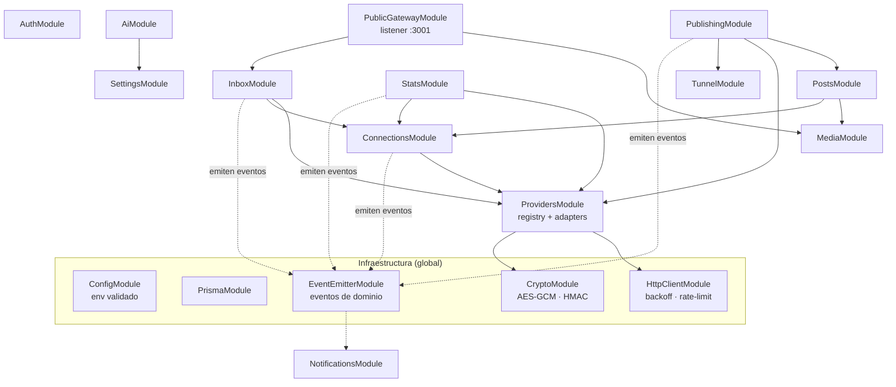

# Paso 4 — Diseño de la API REST (módulos NestJS y endpoints)

> Estado: borrador para revisión · Fecha: 2026-10-05
> Depende de: [02-arquitectura.md](./02-arquitectura.md), [03-modelo-datos.md](./03-modelo-datos.md)

---

## 1. Convenciones

| Tema | Decisión |
|---|---|
| Prefijo | `/api/v1` (listener privado `127.0.0.1:3000`) |
| Formato | JSON; fechas ISO-8601 en UTC; IDs UUIDv7 |
| Autenticación | Cookie de sesión `sh_session` (`httpOnly`, `SameSite=Strict`). `SessionGuard` **global**; las rutas abiertas llevan `@Public()` |
| Validación | `ValidationPipe` global con `whitelist`, `forbidNonWhitelisted` y `transform`. Todos los cuerpos y queries son DTOs con class-validator |
| Paginación | Por cursor: `?cursor=<opaco>&limit=50` → `{ items, nextCursor }`. No usamos *offset*, porque la bandeja y los medios crecen y cambian mientras se recorren |
| Documentación | OpenAPI en `/api/docs` (solo en desarrollo) → `openapi-typescript` genera los tipos de `apps/web` |
| Acciones largas | `202 Accepted` + progreso por SSE (`/api/v1/events`) |
| Rate limit propio | `@nestjs/throttler`: login 5/min; IA 20/min; resto sin límite (un solo usuario) |

### Formato de error (centralizado)

Un único `AllExceptionsFilter` convierte cualquier error al mismo formato:

```json
{
  "statusCode": 409,
  "code": "MEDIA_IN_USE",
  "message": "Este medio está usado por 2 publicaciones programadas.",
  "details": { "targetIds": ["…", "…"] },
  "requestId": "01J…"
}
```

| Origen | Traducción |
|---|---|
| `ValidationError` (class-validator) | 400 `VALIDATION_FAILED` + `details.fields` |
| Prisma `P2002` / `P2025` / `P2003` | 409 `CONFLICT` / 404 `NOT_FOUND` / 409 `IN_USE` |
| `ProviderError` | Ver tabla de §5 |
| Cualquier otro | 500 `INTERNAL`: el mensaje real solo va al log (redactado), nunca a la respuesta |

---

## 2. Módulos y dependencias



**Por qué hay eventos de dominio** (`@nestjs/event-emitter`): los módulos de publicación, bandeja y estadísticas **no conocen** a `NotificationsModule`. Emiten `post.published`, `inbox.new_items`, `account.needs_reconnect`… y `NotificationsModule` los persiste y los empuja por SSE. Así se pueden añadir o quitar notificaciones sin tocar la lógica de negocio.

| Módulo | Responsabilidad | Crons |
|---|---|---|
| `auth` | Configuración inicial, login/logout, sesiones, cambio de contraseña | limpieza de sesiones caducadas (diario) |
| `connections` | OAuth (state + PKCE), alta y baja de cuentas, renovación de tokens, salud | `token-refresh` (cada hora) |
| `providers` | `ProviderAdapter` por red, catálogo de métricas, reglas de formato | — |
| `media` | Subida, deduplicación, miniaturas (sharp), servicio privado de archivos, URLs firmadas | `media-cleanup` (diario) |
| `posts` | Posts, variantes, validación por red, calendario, duplicar, restaurar | — |
| `publishing` | Ejecución de la publicación, idempotencia, conciliación, recuperación | `publish-due` (cada minuto) + al arrancar |
| `inbox` | Polling de comentarios y DMs, respuestas, ocultar/borrar, webhooks de WhatsApp | `inbox-poll` |
| `stats` | Snapshots, backfill, series, ranking, mejores horarios, export CSV | `daily-snapshot`, `stories-metrics` |
| `notifications` | Persistencia y stream SSE | — |
| `settings` | Ajustes validados por clave; secretos cifrados | — |
| `ai` | Sugerencias de copy con la API key del usuario (opcional) | — |
| `tunnel` | Detecta la URL pública (cloudflared `/quicktunnel` o `PUBLIC_BASE_URL`) y su estado | comprobación cada 5 min |
| `public-gateway` | Solo `/public-media/:token` y `/webhooks/whatsapp` | — |

---

## 3. Contrato de los adaptadores

```ts
// apps/api/src/modules/providers/provider-adapter.ts
export interface Capabilities {
  publishFormats: PostFormat[];              // p. ej. IG: FEED, CAROUSEL, REEL, STORY
  requiresPublicMediaUrl: boolean;           // IG/Threads: true → necesita túnel
  nativeScheduling: boolean;                 // FB: true
  editRemote: boolean;                       // editar el texto ya publicado
  deleteRemote: boolean;                     // IG: false (la API no lo permite)
  comments: { read: boolean; reply: boolean; hide: boolean; delete: boolean };
  directMessages: { read: boolean; reply: boolean; replyWindowHours?: number };
  metrics: CanonicalMetricKey[];             // lo que la UI puede mostrar
}

export interface ProviderAdapter {
  readonly network: Network;
  capabilities(account: AccountContext): Capabilities;   // depende de los scopes concedidos

  // OAuth
  buildAuthorizeUrl(p: { state: string; codeChallenge?: string; redirectUri: string }): string;
  completeAuthorization(p: { code: string; codeVerifier?: string; redirectUri: string })
    : Promise<ConnectedIdentity[]>;                      // FB devuelve N páginas; LinkedIn, perfil + organizaciones
  refreshCredential?(cred: DecryptedCredential): Promise<TokenSet>;

  // Publicación
  validateTarget(t: TargetDraft, account: AccountContext): ValidationIssue[];
  publish(t: PublishableTarget, ctx: ProviderContext): Promise<PublishResult>;
  findRecentlyPublished(ctx: ProviderContext, since: Date): Promise<RemotePostRef[]>; // conciliación
  editRemote?(externalId: string, text: string, ctx: ProviderContext): Promise<void>;
  deleteRemote?(externalId: string, ctx: ProviderContext): Promise<void>;

  // Bandeja
  fetchComments?(ctx: ProviderContext, cursor?: string): Promise<SyncPage<InboxItem>>;
  fetchMessages?(ctx: ProviderContext, cursor?: string): Promise<SyncPage<InboxItem>>;
  replyToComment?(commentId: string, text: string, ctx: ProviderContext): Promise<InboxItem>;
  sendMessage?(threadExternalId: string, text: string, ctx: ProviderContext): Promise<InboxItem>;
  setCommentHidden?(commentId: string, hidden: boolean, ctx: ProviderContext): Promise<void>;
  deleteComment?(commentId: string, ctx: ProviderContext): Promise<void>;

  // Estadísticas
  fetchAccountMetrics(ctx: ProviderContext, day: LocalDate): Promise<CanonicalMetrics>;
  fetchPosts(ctx: ProviderContext, since: Date): Promise<SocialPostData[]>;
  fetchPostMetrics(ctx: ProviderContext, externalIds: string[]): Promise<Record<string, CanonicalMetrics>>;
  backfillAccountMetrics?(ctx: ProviderContext, from: LocalDate, to: LocalDate)
    : Promise<Array<{ day: LocalDate; metrics: CanonicalMetrics }>>;
}
```

`ProviderContext` lleva la cuenta y un **token ya descifrado** que vive solo en memoria durante la llamada, además del `HttpClient` configurado para esa red. Los adaptadores **nunca** leen la BD ni hacen `console.log`.

---

## 4. Endpoints

### 4.1 Auth
| Método | Ruta | Descripción |
|---|---|---|
| GET | `/auth/status` `@Public` | `{ setupRequired, authenticated }`: el frontend decide si mostrar la configuración inicial o el login |
| POST | `/auth/setup` `@Public` | `{ username, password }`. Solo funciona si no existe usuario (si existe → 409) |
| POST | `/auth/login` `@Public` | `{ username, password }` → pone la cookie. Throttle 5/min |
| POST | `/auth/logout` | Revoca la sesión actual |
| GET | `/auth/me` | Usuario actual |
| PATCH | `/auth/password` | `{ currentPassword, newPassword }` → revoca las demás sesiones |

¿Contraseña olvidada? Al ser local, el comando `npm run reset-password` (CLI) la restablece. No hay email.

### 4.2 Conexiones
| Método | Ruta | Descripción |
|---|---|---|
| GET | `/connections/providers` | Redes disponibles: `configured` (si están sus variables en `.env`), capacidades y enlace a la guía de configuración |
| GET | `/connections/:network/authorize` | Crea el `state` (+ PKCE) y **redirige 302** al diálogo de la red |
| GET | `/connections/:network/callback` | Intercambia el `code`, cifra los tokens y crea o actualiza las cuentas. Redirige a `/connections?connected=…` o `?error=…`. En FB conecta **las páginas que elegiste en el diálogo de Meta** |
| GET | `/connections` | Cuentas con `status`, `expiresAt`, `capabilities` y última sincronización |
| GET | `/connections/:id` | Detalle + `syncStates` |
| PATCH | `/connections/:id` | `{ status: ACTIVE \| DISABLED }` |
| POST | `/connections/:id/refresh` | Fuerza la renovación del token |
| POST | `/connections/:id/check` | Verifica el token y los permisos contra la red (`debug_token` en Meta) |
| DELETE | `/connections/:id?cancelScheduled=true` | Desconecta. Sin el flag → 409 si tiene publicaciones programadas |

### 4.3 Medios
| Método | Ruta | Descripción |
|---|---|---|
| GET | `/media?kind&tag&q&cursor&limit` | Biblioteca |
| POST | `/media` (multipart, varios archivos) | Sube, calcula el sha256 (si ya existía, devuelve el existente), genera la miniatura y extrae las dimensiones. Límite configurable (por defecto 1 GB por video y 30 MB por imagen) |
| GET | `/media/:id` | Metadatos + en qué posts se usa |
| PATCH | `/media/:id` | `{ altText, tags }` |
| DELETE | `/media/:id` | 409 `MEDIA_IN_USE` si un target lo usa |
| GET | `/media/:id/file` · `/media/:id/thumbnail` | Archivo privado (con sesión), soporta `Range` para video |

### 4.4 Posts y calendario
| Método | Ruta | Descripción |
|---|---|---|
| GET | `/posts?from&to&accountIds&networks&statuses` | Vista de calendario: posts con targets cuyo `scheduledAt`/`publishedAt` cae en el rango |
| GET | `/posts/drafts?cursor` | Borradores sin fecha |
| POST | `/posts` | Crea el post con sus targets (ver DTO en §6). Queda en `DRAFT` |
| GET | `/posts/:id` | Post + targets + medios + intentos |
| PATCH | `/posts/:id` | `{ title, baseText, notes }` |
| DELETE | `/posts/:id` | Soft delete y cancelación de los targets programados. 409 si alguno está `PUBLISHING` |
| POST | `/posts/:id/restore` | Deshace el borrado |
| POST | `/posts/:id/duplicate` | Copia como borrador |
| POST | `/posts/validate` | **Dry-run**: valida targets contra las reglas de la red y las capacidades → `{ targetIndex, severity, code, message }[]` |
| POST | `/posts/:id/targets` | Añade una variante |
| PUT | `/posts/:id/targets/:targetId` | Edita la variante (solo en `DRAFT`, `SCHEDULED`, `FAILED` o `MISSED`) |
| DELETE | `/posts/:id/targets/:targetId` | Quita la variante (si no se ha publicado) |
| POST | `/posts/:id/schedule` | `{ targets: [{ targetId, scheduledAt }] }` o `{ scheduledAt }` para todos → valida y pasa a `SCHEDULED` |
| PATCH | `/posts/:id/reschedule` | Arrastrar y soltar en el calendario: `{ scheduledAt, targetIds? }` |
| POST | `/posts/:id/unschedule` | Vuelve a `DRAFT` |
| POST | `/posts/:id/publish-now` | `202`; publica ya los targets elegidos |
| POST | `/posts/:id/targets/:targetId/retry` | Para `FAILED` o `MISSED` |
| POST | `/posts/:id/targets/:targetId/resolve` | Para `NEEDS_REVIEW`: `{ outcome: 'was_published', externalUrl? } \| { outcome: 'retry' } \| { outcome: 'cancel' }` |
| PATCH | `/posts/:id/targets/:targetId/remote` | Editar el texto ya publicado (si `editRemote`) |
| DELETE | `/posts/:id/targets/:targetId/remote` | Borrar de la red (si `deleteRemote`; en IG → 422 `CAPABILITY_NOT_SUPPORTED`) |

### 4.5 Hashtags
`GET/POST /hashtag-sets`, `PATCH/DELETE /hashtag-sets/:id`: grupos reutilizables de hashtags.

### 4.6 Bandeja unificada
| Método | Ruta | Descripción |
|---|---|---|
| GET | `/inbox/threads?kind&status&networks&accountIds&unread&q&cursor` | Lista unificada ordenada por `lastMessageAt` |
| GET | `/inbox/threads/:id?cursor` | Hilo + mensajes + post relacionado (miniatura) |
| POST | `/inbox/threads/:id/reply` | `{ text }` → responde al comentario o envía el DM. 422 `REPLY_WINDOW_CLOSED` si la ventana de 24 h ya se cerró |
| PATCH | `/inbox/threads/:id` | `{ status: OPEN \| DONE }` |
| POST | `/inbox/threads/:id/read` | Marca el hilo como leído |
| POST | `/inbox/messages/:id/hide` | `{ hidden: boolean }`, solo comentarios |
| DELETE | `/inbox/messages/:id` | Borra el comentario en la red (si la capacidad lo permite) |
| POST | `/inbox/sync` | `{ accountIds? }` → `202`, sincronizar ahora |
| GET | `/inbox/unread-count` | Para el badge |

### 4.7 Estadísticas
| Método | Ruta | Descripción |
|---|---|---|
| GET | `/stats/availability` | Por cuenta: qué métricas soporta, desde qué fecha hay datos y discontinuidades de catálogo |
| GET | `/stats/overview?from&to&accountIds&compare=previous` | KPIs consolidados y por red, con variación frente al periodo anterior |
| GET | `/stats/timeseries?metrics=followers,reach&from&to&granularity=day\|week\|month&accountIds&groupBy=account\|network\|none` | Series para las gráficas de líneas (con huecos explícitos) |
| GET | `/stats/followers?from&to&granularity&accountIds` | Ganados, perdidos y neto por bucket |
| GET | `/stats/compare?metric&from&to&by=network\|account` | Comparativa entre redes (barras) |
| GET | `/stats/posts/ranking?from&to&metric=engagement_rate\|reach\|views\|…&order=desc\|asc&limit&accountIds&formats` | Mejores y peores publicaciones |
| GET | `/stats/posts/:socialPostId` | Evolución de un post (sus snapshots) |
| GET | `/stats/best-times?from&to&accountIds&metric=engagement_rate` | Matriz 7×24 con `{ value, sampleSize }`; en IG añade `onlineFollowers` |
| POST | `/stats/sync` | `{ accountIds? }` → `202 { jobId }`. "Sincronizar ahora": si ya hay una en curso, devuelve la misma |
| GET | `/stats/sync/:jobId` | Estado (también se emite por SSE) |
| GET | `/stats/export.csv?report=overview\|timeseries\|followers\|ranking&…` | CSV en streaming, UTF-8 con BOM (para que Excel muestre bien las tildes) |

**PDF:** se genera **en el navegador**, desde una ruta del frontend `/reports/print?…` con estilos de impresión y el diálogo "Guardar como PDF". Las gráficas de Recharts son SVG y se imprimen nítidas. Generarlo en el servidor obligaría a añadir Chromium/Puppeteer (~400 MB en la imagen Docker) solo para esto. Lo explico en §7.

### 4.8 Notificaciones y eventos
| Método | Ruta | Descripción |
|---|---|---|
| GET | `/notifications?unread&cursor` | Lista |
| POST | `/notifications/:id/read` · `/notifications/read-all` | Marcar como leídas |
| GET | `/events` (SSE) | Stream con `notification.created`, `post.status_changed`, `inbox.updated`, `sync.progress`, `tunnel.status` |

### 4.9 Ajustes, IA y sistema
| Método | Ruta | Descripción |
|---|---|---|
| GET / PATCH | `/settings` | Claves conocidas y validadas: `publishing.missedGraceMinutes`, `stats.engagementBasis`, `inbox.pollMinutes`, `stats.snapshotHour`… |
| GET | `/ai/status` | `{ enabled, hasKey, model }` |
| PUT / DELETE | `/ai/key` | Guarda la API key de Anthropic cifrada (antes la valida con una llamada mínima) o la borra |
| POST | `/ai/suggest` | `{ baseText, accountIds[], tone?, goal?, language }` → una propuesta por red respetando sus límites + hashtags sugeridos |
| GET | `/system/health` | BD, túnel, versión, última ejecución de cada cron |
| GET | `/healthz` `@Public` | Para el healthcheck de Docker (solo `{ ok: true }`) |

### 4.10 Listener público `:3001` (lo único expuesto vía túnel)
| Método | Ruta | Descripción |
|---|---|---|
| GET | `/public-media/:token` | `token = base64url({ mediaId, exp }) + "." + HMAC-SHA256`. Caduca en 1 h y soporta `Range` |
| GET | `/webhooks/whatsapp` | Verificación (`hub.challenge`) con `WHATSAPP_WEBHOOK_VERIFY_TOKEN` |
| POST | `/webhooks/whatsapp` | Valida `X-Hub-Signature-256` con el app secret y luego encola en la bandeja |
| * | cualquier otra | 404, sin CORS ni cookies ni cabecera `Server` |

---

## 5. Errores de proveedor, reintentos y rate limits

`HttpClient` común (basado en `undici`) por red:

| Situación | Clasificación | Acción |
|---|---|---|
| 429, 5xx, timeout, `ECONNRESET`; Meta códigos 1, 2, 4, 17, 32, 341, 613 | `retryable` / `rateLimited` | Backoff exponencial con *full jitter*: base 1 s, ×2, tope 60 s, máx. 5 intentos; respeta `Retry-After`. Si el rate limit persiste → `sync_states.backoff_until` y notificación `RATE_LIMITED` |
| Cabeceras `X-App-Usage` / `X-Business-Use-Case-Usage` > 80 % | preventivo | El cliente pausa esa cuenta hasta `estimated_time_to_regain_access` |
| 401, Meta 190 (token inválido) | `authExpired` | Intenta renovar una vez; si falla → cuenta `NEEDS_RECONNECT` + notificación |
| Meta 10 / 200–299 (permiso) | `permissionMissing` | 403 `PROVIDER_PERMISSION_MISSING` con el permiso que falta |
| 400 de validación de la red | `rejected` | 422 `PROVIDER_REJECTED` con el mensaje de la red saneado |

**Publicar no es idempotente.** Los `POST` que crean contenido **no se reintentan a ciegas**. Ante un timeout o un 5xx en el paso final (`media_publish`, `POST /rest/posts`), primero se ejecuta `findRecentlyPublished()` para comprobar si el post ya existe, y solo después se decide si reintentar. Crear un contenedor de IG sí es seguro de reintentar, porque un contenedor sin publicar caduca solo.

**Redacción en logs:** `HttpClient` registra el método, el host, la ruta **sin query**, el status y la duración. Nunca registra cabeceras de autorización, cuerpos con tokens ni `access_token` en la URL.

---

## 6. Ejemplo de DTO

```ts
export class CreateTargetDto {
  @IsUUID(7) accountId!: string;
  @IsEnum(PostFormat) format!: PostFormat;
  @IsString() @MaxLength(63_206) text!: string;            // tope global; el límite real por red lo valida el adaptador
  @IsOptional() @IsString() @MaxLength(2_200) firstComment?: string;
  @IsArray() @ArrayMaxSize(20) @IsUUID(7, { each: true }) mediaIds: string[] = [];
  @IsOptional() @IsISO8601({ strict: true }) scheduledAt?: string;
  @IsOptional() @IsObject() options?: Record<string, unknown>; // validado después por el adaptador de la red
}

export class CreatePostDto {
  @IsOptional() @IsString() @MaxLength(200) title?: string;
  @IsString() @MaxLength(63_206) baseText!: string;
  @IsArray() @ArrayMinSize(1) @ValidateNested({ each: true }) @Type(() => CreateTargetDto)
  targets!: CreateTargetDto[];
}
```

La validación tiene dos capas. class-validator revisa la **forma** del DTO. `adapter.validateTarget()` revisa las **reglas de la red**: longitud, nº de hashtags, formatos y proporción de los medios, duración de video, que exista túnel si `requiresPublicMediaUrl`… Las reglas viven en `packages/shared` y el editor del frontend las usa para validar en vivo.

---

## 7. Decisiones de este paso (resumen)

1. **Eventos de dominio en lugar de llamadas directas a notificaciones**, para mantener el desacoplamiento.
2. **Capacidades por cuenta**: la UI nunca ofrece algo que la red o los permisos concedidos no permitan.
3. **PDF en el navegador** (ruta imprimible) en lugar de Puppeteer en el servidor. Ventaja: cero dependencias y gráficas vectoriales. Inconveniente: el usuario pulsa "Guardar como PDF" en el diálogo de impresión en lugar de descargar el archivo directamente.
4. **Reconciliar antes de reintentar** al publicar, para no duplicar posts.
5. **Sin endpoint de recuperación de contraseña por email**: basta un comando CLI local.
